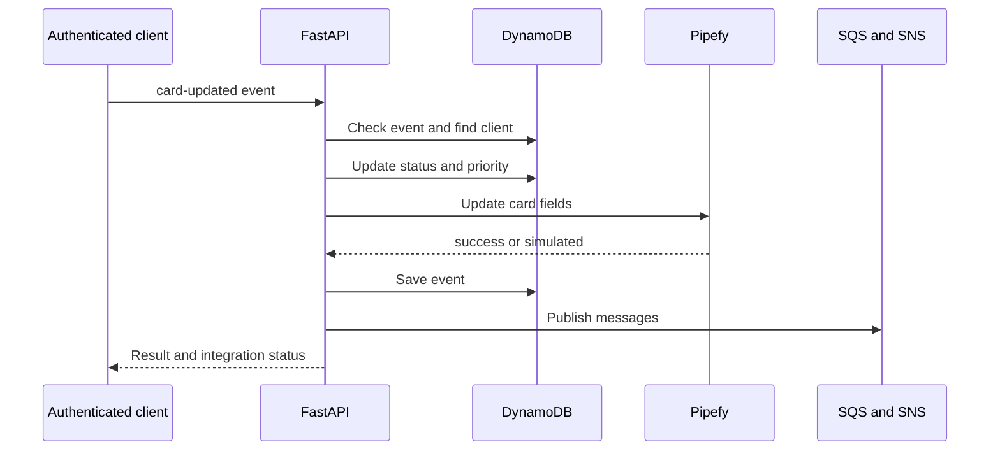

# System Architecture

Client-request CRM integrated with Pipefy cards. It registers clients, processes an authenticated simulated webhook, calculates priority from assets and publishes SQS/SNS events. LocalStack represents AWS services in development. Responses indicate whether Pipefy execution was real or simulated.

## Implemented behavior

Python 3.12, FastAPI 0.115.12, Pydantic 2.11.3, boto3 1.38.19, HTTPX 0.28.1 and PyJWT 2.10.1. Backend separates domain, application, infrastructure and interfaces; dependencies connect ports to DynamoDB, SQS, SNS and Pipefy. Next.js 16.2.6/React 19.2.4 frontend uses React Hook Form/Zod and TanStack Query. Domain/use cases are separate from UI, although several HTTP errors originate in use cases.

## Related files

- [backend/app/application/use_cases/create_client.py](https://github.com/Vidigal-code/pipebridge-crm/blob/c2273860c28f959a64f15ee2a7ae215f93a0802a/backend/app/application/use_cases/create_client.py)
- [backend/app/application/use_cases/process_webhook.py](https://github.com/Vidigal-code/pipebridge-crm/blob/c2273860c28f959a64f15ee2a7ae215f93a0802a/backend/app/application/use_cases/process_webhook.py)
- [backend/app/domain/entities/client.py](https://github.com/Vidigal-code/pipebridge-crm/blob/c2273860c28f959a64f15ee2a7ae215f93a0802a/backend/app/domain/entities/client.py)
- [backend/app/interfaces/api/routes/webhook_routes.py](https://github.com/Vidigal-code/pipebridge-crm/blob/c2273860c28f959a64f15ee2a7ae215f93a0802a/backend/app/interfaces/api/routes/webhook_routes.py)
- [backend/app/infrastructure/external/pipefy_client.py](https://github.com/Vidigal-code/pipebridge-crm/blob/c2273860c28f959a64f15ee2a7ae215f93a0802a/backend/app/infrastructure/external/pipefy_client.py)
- [localstack/init-aws.sh](https://github.com/Vidigal-code/pipebridge-crm/blob/c2273860c28f959a64f15ee2a7ae215f93a0802a/localstack/init-aws.sh)
- [docker-compose.yml](https://github.com/Vidigal-code/pipebridge-crm/blob/c2273860c28f959a64f15ee2a7ae215f93a0802a/docker-compose.yml)

## Navigation

- [Project guide](?menu=en&lang=en&id=6)
- [Source reference](?menu=en&lang=en&id=7)
