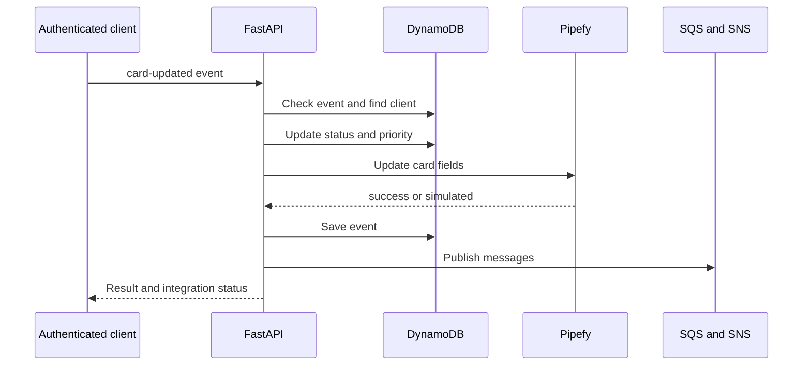

# Project Overview

Client-request CRM integrated with Pipefy cards. It registers clients, processes an authenticated simulated webhook, calculates priority from assets and publishes SQS/SNS events. LocalStack represents AWS services in development. Responses indicate whether Pipefy execution was real or simulated.

## Implemented behavior

Python 3.12, FastAPI 0.115.12, Pydantic 2.11.3, boto3 1.38.19, HTTPX 0.28.1 and PyJWT 2.10.1. Backend separates domain, application, infrastructure and interfaces; dependencies connect ports to DynamoDB, SQS, SNS and Pipefy. Next.js 16.2.6/React 19.2.4 frontend uses React Hook Form/Zod and TanStack Query. Domain/use cases are separate from UI, although several HTTP errors originate in use cases.



## Workflow and failure cases

1. POST /auth/login validates a password and returns Bearer JWT; PUT /auth/password changes it. /clientes CRUD and /pipefy/cards require a user. The webhook also uses get_current_user: it is not a public endpoint accepting arbitrary unauthenticated Pipefy callbacks.

2. Client creation validates name, email, request and assets; persists Client with Aguardando Análise in DynamoDB; invokes createCard; assigns card_id only on success with an ID; publishes SNS. With simulated fallback the local client can exist without a real card. Listing/editing/deletion and card operations have separate routes.

3. POST /webhooks/pipefy/card-updated receives event_id, card_id, cliente_email and timestamp. Recorded event returns 409; missing client returns 404. An already-associated card_id takes precedence. It marks Processado and prioridade_alta for assets >= 200000, otherwise prioridade_normal. It updates client/Pipefy fields, records the event, sends SQS and publishes SNS in that order.

4. PipefyClient builds createCard/updateFieldsValues and other GraphQL operations with configurable field IDs. HTTP/GraphQL errors or unavailability can produce simulated results. Display and inspect pipefy_status/pipefy_message. Publishing to SQS does not imply a reconciliation worker: this repository does not guarantee automatic fallback replay.

## Configuration and deployment

Copy .env.example.txt to .env; configure LocalStack/AWS, tables/queues/topic, Pipefy token/pipe/fields and authentication. docker compose up --build runs localstack/init-aws.sh. Default backend: 8001; frontend: 3000; Swagger /pt/docs and /en/docs. Install requirements.txt and run python -m pytest tests/ -v; frontend has lint/build. For 409 check event_id; 404 email; simulated token/IDs/logs; AWS failures endpoint/region/initialized resources. README Lambda/ECS architecture is a possible evolution, not provisioned deployment.

## Execution commands

```sh
docker compose up --build
# Validation in a separately configured test environment
python -m pip install -r backend/requirements.txt
cd backend
python -m pytest tests/ -v
cd ..
npm --prefix frontend ci
npm --prefix frontend run build
```

## Related files

- [backend/app/application/use_cases/create_client.py](https://github.com/Vidigal-code/pipebridge-crm/blob/c2273860c28f959a64f15ee2a7ae215f93a0802a/backend/app/application/use_cases/create_client.py)
- [backend/app/application/use_cases/process_webhook.py](https://github.com/Vidigal-code/pipebridge-crm/blob/c2273860c28f959a64f15ee2a7ae215f93a0802a/backend/app/application/use_cases/process_webhook.py)
- [backend/app/domain/entities/client.py](https://github.com/Vidigal-code/pipebridge-crm/blob/c2273860c28f959a64f15ee2a7ae215f93a0802a/backend/app/domain/entities/client.py)
- [backend/app/interfaces/api/routes/webhook_routes.py](https://github.com/Vidigal-code/pipebridge-crm/blob/c2273860c28f959a64f15ee2a7ae215f93a0802a/backend/app/interfaces/api/routes/webhook_routes.py)
- [backend/app/infrastructure/external/pipefy_client.py](https://github.com/Vidigal-code/pipebridge-crm/blob/c2273860c28f959a64f15ee2a7ae215f93a0802a/backend/app/infrastructure/external/pipefy_client.py)
- [localstack/init-aws.sh](https://github.com/Vidigal-code/pipebridge-crm/blob/c2273860c28f959a64f15ee2a7ae215f93a0802a/localstack/init-aws.sh)
- [docker-compose.yml](https://github.com/Vidigal-code/pipebridge-crm/blob/c2273860c28f959a64f15ee2a7ae215f93a0802a/docker-compose.yml)

## Navigation

- [Project guide](?menu=en&lang=en&id=6)
- [Source reference](?menu=en&lang=en&id=7)
