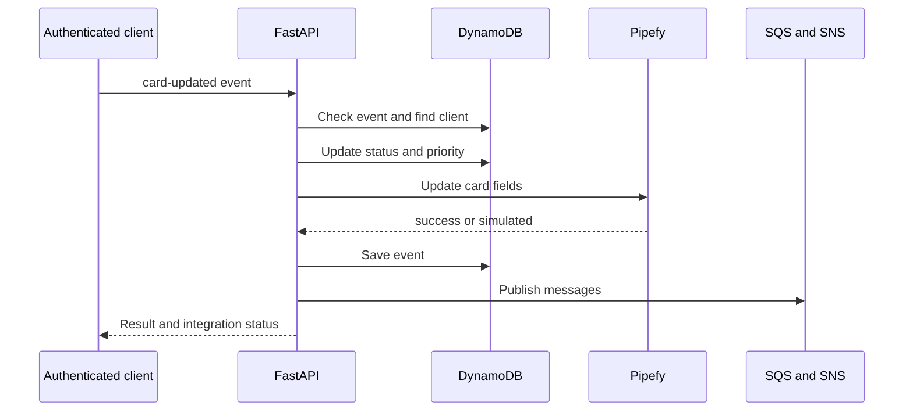

# Arquitectura del Sistema

CRM de solicitudes integrado con cards Pipefy. Registra clientes, procesa webhook simulado/autenticado, calcula prioridad por patrimonio y publica eventos SQS/SNS. LocalStack representa AWS en desarrollo. Las respuestas indican ejecución Pipefy real o simulada.

## Comportamiento implementado

Python 3.12, FastAPI 0.115.12, Pydantic 2.11.3, boto3 1.38.19, HTTPX 0.28.1 y PyJWT 2.10.1. Backend separa domain, application, infrastructure e interfaces; conecta puertos a DynamoDB/SQS/SNS/Pipefy. Frontend Next.js 16.2.6/React 19.2.4 usa React Hook Form/Zod y TanStack Query. Dominio/casos de uso se separan de UI, aunque varios errores HTTP nacen en casos de uso.

## Archivos relacionados

- [backend/app/application/use_cases/create_client.py](https://github.com/Vidigal-code/pipebridge-crm/blob/c2273860c28f959a64f15ee2a7ae215f93a0802a/backend/app/application/use_cases/create_client.py)
- [backend/app/application/use_cases/process_webhook.py](https://github.com/Vidigal-code/pipebridge-crm/blob/c2273860c28f959a64f15ee2a7ae215f93a0802a/backend/app/application/use_cases/process_webhook.py)
- [backend/app/domain/entities/client.py](https://github.com/Vidigal-code/pipebridge-crm/blob/c2273860c28f959a64f15ee2a7ae215f93a0802a/backend/app/domain/entities/client.py)
- [backend/app/interfaces/api/routes/webhook_routes.py](https://github.com/Vidigal-code/pipebridge-crm/blob/c2273860c28f959a64f15ee2a7ae215f93a0802a/backend/app/interfaces/api/routes/webhook_routes.py)
- [backend/app/infrastructure/external/pipefy_client.py](https://github.com/Vidigal-code/pipebridge-crm/blob/c2273860c28f959a64f15ee2a7ae215f93a0802a/backend/app/infrastructure/external/pipefy_client.py)
- [localstack/init-aws.sh](https://github.com/Vidigal-code/pipebridge-crm/blob/c2273860c28f959a64f15ee2a7ae215f93a0802a/localstack/init-aws.sh)
- [docker-compose.yml](https://github.com/Vidigal-code/pipebridge-crm/blob/c2273860c28f959a64f15ee2a7ae215f93a0802a/docker-compose.yml)

## Navegación

- [Project guide](?menu=es&lang=es&id=6)
- [Source reference](?menu=es&lang=es&id=7)
