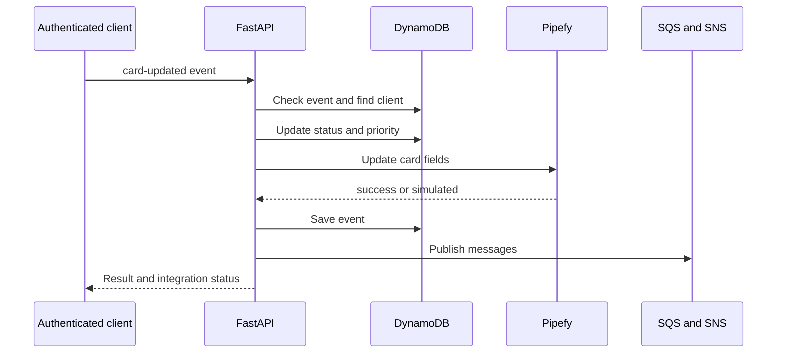

# pipebridge-crm: Contexto y flujos del proyecto

GitPageDocs **0.0.17** · 1.0.0 · 2026-10-29

## Contexto

CRM de solicitudes integrado con cards Pipefy. Registra clientes, procesa webhook simulado/autenticado, calcula prioridad por patrimonio y publica eventos SQS/SNS. LocalStack representa AWS en desarrollo. Las respuestas indican ejecución Pipefy real o simulada.

## Stack y arquitectura

Python 3.12, FastAPI 0.115.12, Pydantic 2.11.3, boto3 1.38.19, HTTPX 0.28.1 y PyJWT 2.10.1. Backend separa domain, application, infrastructure e interfaces; conecta puertos a DynamoDB/SQS/SNS/Pipefy. Frontend Next.js 16.2.6/React 19.2.4 usa React Hook Form/Zod y TanStack Query. Dominio/casos de uso se separan de UI, aunque varios errores HTTP nacen en casos de uso.

## Flujos completos

1. POST /auth/login valida contraseña y devuelve Bearer JWT; PUT /auth/password la cambia. CRUD /clientes y /pipefy/cards requieren usuario. El webhook también usa get_current_user; no acepta callbacks Pipefy arbitrarios sin credenciales.

2. Crear cliente valida nombre/email/solicitud/patrimonio; persiste Client Aguardando Análise en DynamoDB; llama createCard; asocia card_id solo con éxito e ID; publica SNS. Con fallback simulated puede existir cliente local sin card real. Lista/edición/eliminación y cards son rutas separadas.

3. POST /webhooks/pipefy/card-updated recibe event_id, card_id, cliente_email y timestamp. Evento registrado: 409; cliente ausente: 404. Tiene preferencia card_id ya asociado. Marca Processado y prioridade_alta para patrimonio >= 200000; si no prioridade_normal. Actualiza cliente/Pipefy, registra evento, envía SQS y publica SNS en ese orden.

4. PipefyClient construye createCard/updateFieldsValues y otras operaciones GraphQL con IDs configurables. Fallos HTTP/GraphQL o indisponibilidad pueden producir simulación. Muestre/revise pipefy_status/pipefy_message. Publicar SQS no implica worker de reconciliación; el repositorio no garantiza replay automático del fallback.

## Datos, seguridad y límites

JWT HS256/PBKDF2-SHA256 protegen autenticación; middleware maneja headers, CORS, request ID y límites IP. Cambie credenciales seed/JWT_SECRET antes de exponer. Deduplicación consulta event_id antes de escribir sin transacción global; concurrencia y fallos posteriores requieren reconciliación. DynamoDB/Pipefy/SQS/SNS no son atómicos juntos. Es un CRM compartido, sin aislamiento multi-tenant por usuario en estos casos de uso.

## Ejecución, pruebas y operación

Copie .env.example.txt a .env; configure LocalStack/AWS, tablas/colas/tópico, token/pipe/fields Pipefy y autenticación. docker compose up --build ejecuta localstack/init-aws.sh. Backend: 8001; frontend: 3000; Swagger /pt/docs y /en/docs. Instale requirements.txt y ejecute python -m pytest tests/ -v; frontend lint/build. Ante 409 revise event_id; 404 email; simulated token/IDs/logs; fallo AWS endpoint/región/recursos. Lambda/ECS en README es una evolución posible, no despliegue provisionado.

## Referencia completa

Dependencias, comandos, endpoints, variables, contratos y pruebas están en la [referencia del código](?menu=es&lang=es&id=7).

## Fuentes verificables

- [backend/app/application/use_cases/create_client.py](https://github.com/Vidigal-code/pipebridge-crm/blob/c2273860c28f959a64f15ee2a7ae215f93a0802a/backend/app/application/use_cases/create_client.py)

- [backend/app/application/use_cases/process_webhook.py](https://github.com/Vidigal-code/pipebridge-crm/blob/c2273860c28f959a64f15ee2a7ae215f93a0802a/backend/app/application/use_cases/process_webhook.py)

- [backend/app/domain/entities/client.py](https://github.com/Vidigal-code/pipebridge-crm/blob/c2273860c28f959a64f15ee2a7ae215f93a0802a/backend/app/domain/entities/client.py)

- [backend/app/interfaces/api/routes/webhook_routes.py](https://github.com/Vidigal-code/pipebridge-crm/blob/c2273860c28f959a64f15ee2a7ae215f93a0802a/backend/app/interfaces/api/routes/webhook_routes.py)

- [backend/app/infrastructure/external/pipefy_client.py](https://github.com/Vidigal-code/pipebridge-crm/blob/c2273860c28f959a64f15ee2a7ae215f93a0802a/backend/app/infrastructure/external/pipefy_client.py)

- [localstack/init-aws.sh](https://github.com/Vidigal-code/pipebridge-crm/blob/c2273860c28f959a64f15ee2a7ae215f93a0802a/localstack/init-aws.sh)

- [docker-compose.yml](https://github.com/Vidigal-code/pipebridge-crm/blob/c2273860c28f959a64f15ee2a7ae215f93a0802a/docker-compose.yml)
