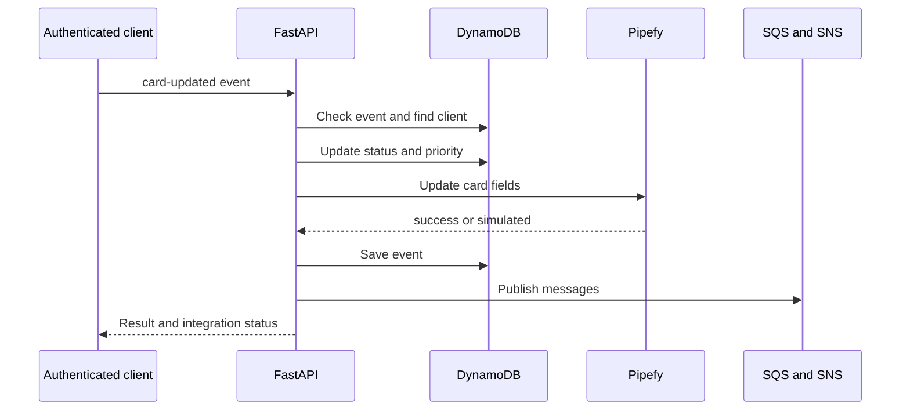

# Arquitetura do Sistema

CRM de solicitações de clientes integrado a cards Pipefy. Cadastra clientes, processa um webhook simulado/autenticado, calcula prioridade por patrimônio e publica eventos em SQS/SNS. LocalStack representa os serviços AWS no desenvolvimento. As respostas indicam se a operação Pipefy foi real ou simulada.

## Comportamento implementado

Python 3.12, FastAPI 0.115.12, Pydantic 2.11.3, boto3 1.38.19, HTTPX 0.28.1 e PyJWT 2.10.1. Backend separa domain, application, infrastructure e interfaces; dependências ligam portas a DynamoDB, SQS, SNS e Pipefy. Frontend Next.js 16.2.6/React 19.2.4 usa React Hook Form/Zod e TanStack Query. Classes de domínio e casos de uso são independentes da interface web, mas vários erros HTTP são lançados nos casos de uso.

## Arquivos relacionados

- [backend/app/application/use_cases/create_client.py](https://github.com/Vidigal-code/pipebridge-crm/blob/c2273860c28f959a64f15ee2a7ae215f93a0802a/backend/app/application/use_cases/create_client.py)
- [backend/app/application/use_cases/process_webhook.py](https://github.com/Vidigal-code/pipebridge-crm/blob/c2273860c28f959a64f15ee2a7ae215f93a0802a/backend/app/application/use_cases/process_webhook.py)
- [backend/app/domain/entities/client.py](https://github.com/Vidigal-code/pipebridge-crm/blob/c2273860c28f959a64f15ee2a7ae215f93a0802a/backend/app/domain/entities/client.py)
- [backend/app/interfaces/api/routes/webhook_routes.py](https://github.com/Vidigal-code/pipebridge-crm/blob/c2273860c28f959a64f15ee2a7ae215f93a0802a/backend/app/interfaces/api/routes/webhook_routes.py)
- [backend/app/infrastructure/external/pipefy_client.py](https://github.com/Vidigal-code/pipebridge-crm/blob/c2273860c28f959a64f15ee2a7ae215f93a0802a/backend/app/infrastructure/external/pipefy_client.py)
- [localstack/init-aws.sh](https://github.com/Vidigal-code/pipebridge-crm/blob/c2273860c28f959a64f15ee2a7ae215f93a0802a/localstack/init-aws.sh)
- [docker-compose.yml](https://github.com/Vidigal-code/pipebridge-crm/blob/c2273860c28f959a64f15ee2a7ae215f93a0802a/docker-compose.yml)

## Navegação

- [Project guide](?menu=pt&lang=pt&id=6)
- [Source reference](?menu=pt&lang=pt&id=7)
