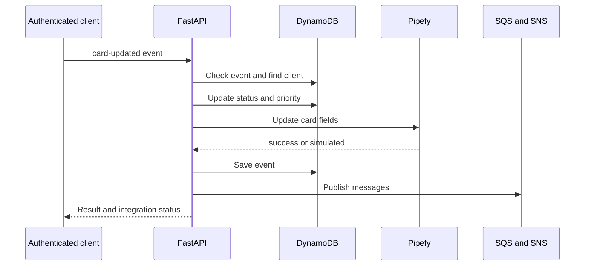

# Visão Geral do Projeto

CRM de solicitações de clientes integrado a cards Pipefy. Cadastra clientes, processa um webhook simulado/autenticado, calcula prioridade por patrimônio e publica eventos em SQS/SNS. LocalStack representa os serviços AWS no desenvolvimento. As respostas indicam se a operação Pipefy foi real ou simulada.

## Comportamento implementado

Python 3.12, FastAPI 0.115.12, Pydantic 2.11.3, boto3 1.38.19, HTTPX 0.28.1 e PyJWT 2.10.1. Backend separa domain, application, infrastructure e interfaces; dependências ligam portas a DynamoDB, SQS, SNS e Pipefy. Frontend Next.js 16.2.6/React 19.2.4 usa React Hook Form/Zod e TanStack Query. Classes de domínio e casos de uso são independentes da interface web, mas vários erros HTTP são lançados nos casos de uso.



## Fluxo e casos de falha

1. POST /auth/login valida senha e retorna Bearer JWT; PUT /auth/password altera senha. CRUD /clientes e rotas /pipefy/cards exigem usuário. O webhook também usa get_current_user: não é um endpoint público que recebe qualquer callback Pipefy sem credenciais.

2. Criar cliente valida nome, email, solicitação e patrimônio; persiste Client com status Aguardando Análise no DynamoDB; chama createCard; só associa card_id quando a integração retorna sucesso e ID; publica SNS. Se Pipefy retornar fallback simulated, o cliente local pode existir sem card real. Lista/edição/exclusão e operações sobre cards são rotas separadas.

3. POST /webhooks/pipefy/card-updated recebe event_id, card_id, cliente_email e timestamp. Evento já registrado retorna 409; cliente ausente, 404. Usa card_id já associado ao cliente quando disponível. Marca Processado e prioridade_alta para patrimônio >= 200000; abaixo disso prioridade_normal. Atualiza cliente e campos Pipefy, grava evento, envia SQS e publica SNS, nessa ordem.

4. PipefyClient monta createCard/updateFieldsValues e demais operações GraphQL com IDs de campo configuráveis. Falha HTTP, erro GraphQL ou indisponibilidade pode acionar resultado simulado. O retorno pipefy_status/pipefy_message deve ser exibido e verificado. Publicar SQS não significa existir um worker de reconciliação: este repositório não implementa uma garantia de replay automático do fallback.

## Configuração e implantação

Copie .env.example.txt para .env; configure LocalStack/AWS, tabelas, filas/tópico, Pipefy token/pipe/fields e autenticação. docker compose up --build executa inicialização em localstack/init-aws.sh. Backend padrão: 8001; frontend: 3000; Swagger /pt/docs e /en/docs. Instale requirements.txt e rode python -m pytest tests/ -v; frontend tem lint/build. Para 409 confira event_id; 404 confira email; simulated confira token/IDs/logs; falha AWS confira endpoint, região e recursos inicializados. A visão Lambda/ECS do README é uma possibilidade de evolução, não um deploy provisionado por este código.

## Comandos de execução

```sh
docker compose up --build
# Validation in a separately configured test environment
python -m pip install -r backend/requirements.txt
cd backend
python -m pytest tests/ -v
cd ..
npm --prefix frontend ci
npm --prefix frontend run build
```

## Arquivos relacionados

- [backend/app/application/use_cases/create_client.py](https://github.com/Vidigal-code/pipebridge-crm/blob/c2273860c28f959a64f15ee2a7ae215f93a0802a/backend/app/application/use_cases/create_client.py)
- [backend/app/application/use_cases/process_webhook.py](https://github.com/Vidigal-code/pipebridge-crm/blob/c2273860c28f959a64f15ee2a7ae215f93a0802a/backend/app/application/use_cases/process_webhook.py)
- [backend/app/domain/entities/client.py](https://github.com/Vidigal-code/pipebridge-crm/blob/c2273860c28f959a64f15ee2a7ae215f93a0802a/backend/app/domain/entities/client.py)
- [backend/app/interfaces/api/routes/webhook_routes.py](https://github.com/Vidigal-code/pipebridge-crm/blob/c2273860c28f959a64f15ee2a7ae215f93a0802a/backend/app/interfaces/api/routes/webhook_routes.py)
- [backend/app/infrastructure/external/pipefy_client.py](https://github.com/Vidigal-code/pipebridge-crm/blob/c2273860c28f959a64f15ee2a7ae215f93a0802a/backend/app/infrastructure/external/pipefy_client.py)
- [localstack/init-aws.sh](https://github.com/Vidigal-code/pipebridge-crm/blob/c2273860c28f959a64f15ee2a7ae215f93a0802a/localstack/init-aws.sh)
- [docker-compose.yml](https://github.com/Vidigal-code/pipebridge-crm/blob/c2273860c28f959a64f15ee2a7ae215f93a0802a/docker-compose.yml)

## Navegação

- [Project guide](?menu=pt&lang=pt&id=6)
- [Source reference](?menu=pt&lang=pt&id=7)
